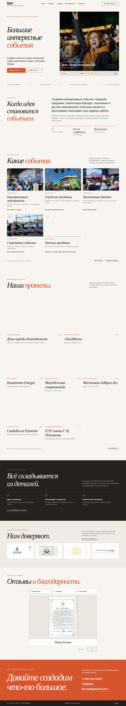
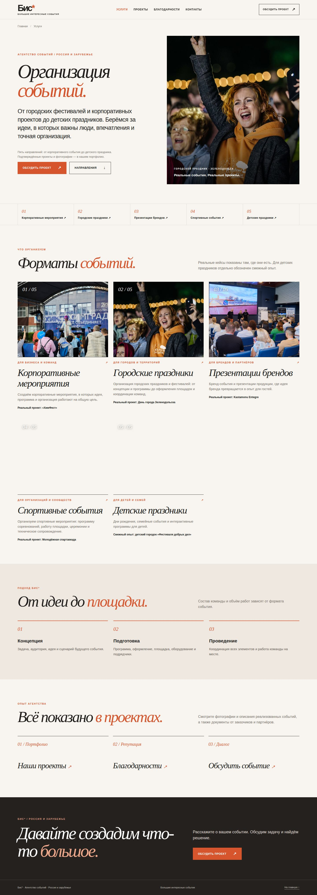
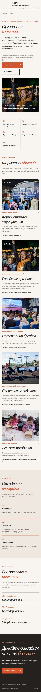
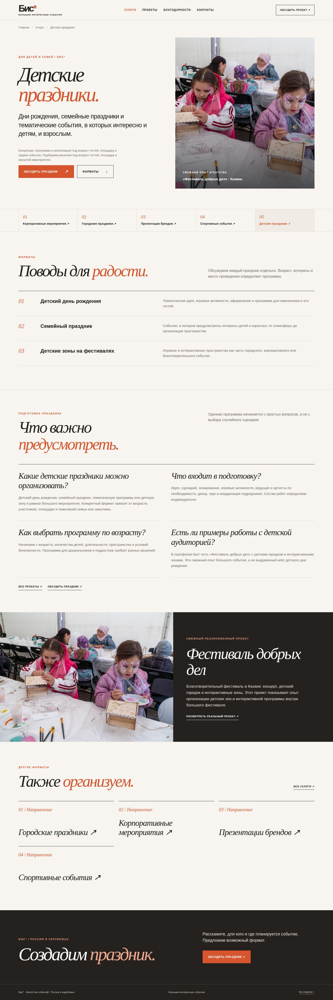
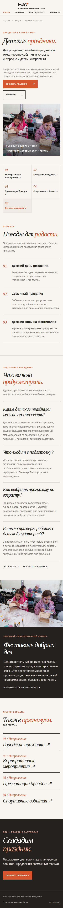
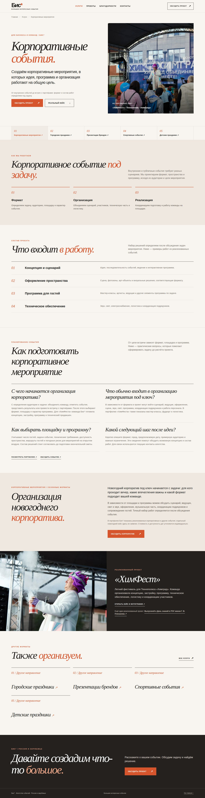
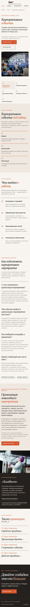
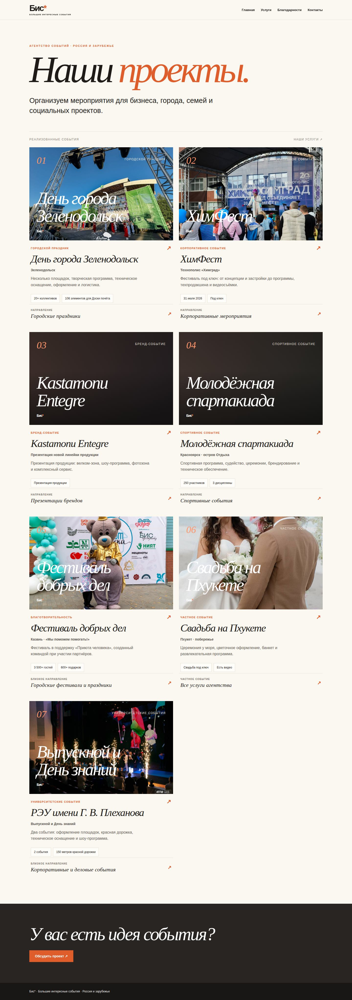
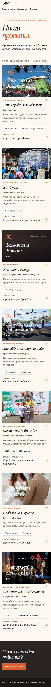

# Бис* — версия 2 | Визуальный обзор и проверка
**Статус:** отдельная рабочая версия в GitHub; основной сайт не меняется.

> Это визуальная галерея из настоящего браузерного рендера GitHub Actions, **не отдельный опубликованный сайт**. Снимки обновляются GitHub Actions в ветке `bis-v2-development`. Интерактивный сайт остаётся на утверждённой основной версии до согласования.

## Главная
**Настольный экран**

**Телефон**

## Направления событий
**Каталог услуг**

**Детские праздники и семейные события**

**Корпоративные мероприятия**

## Реальное портфолио

## Что есть в BIS V2
- 1 главная страница и 1 общий каталог услуг.
- **5 коммерческих направлений**: корпоративные, городские, брендовые, спортивные, детские события.
- 1 каталог проектов с **7 настоящими кейсами**, переходы в услуги и обратно.
- 1 раздел благодарностей с оригинальными материалами.
- Контакты: `+7 963 122-33-99`; `bis.manager@vk.com`; Telegram по ранее согласованной ссылке.
- SEO: canonical, социальные метаданные, sitemap (16 URL), без копий «под каждый город».
- Все страницы проверяются автоматически в браузере на десктопе, мобильном экране 390 px и узком экране 320 px.

## Что нужно подтвердить до публикации
- Внешний вид и удобство мобильного меню по этой галерее.
- Спорная цифра по Kastamonu (до уточнения скрыта в версии 2).
- Собственный домен (пока используется официальный адрес GitHub Pages).
- Снять служебный `noindex` из черновой главной и прогнать релизный тест.
- **Никаких вымышленных кейсов**: фото фестиваля на детской странице обозначено как смежный опыт, не детский день рождения.

## Где смотреть исходники
- [Версия 2, ветка GitHub](https://github.com/hangildin/bis-site/tree/bis-v2-development)
- [Все изменения версии 2, черновик PR](https://github.com/hangildin/bis-site/pull/9)
- [Автоматическая визуальная проверка](https://github.com/hangildin/bis-site/actions/workflows/bis-v2-browser.yml)

**Правило:** все правки только в `bis-v2-development`. В основную ветку `main` нельзя вливать до согласования.
